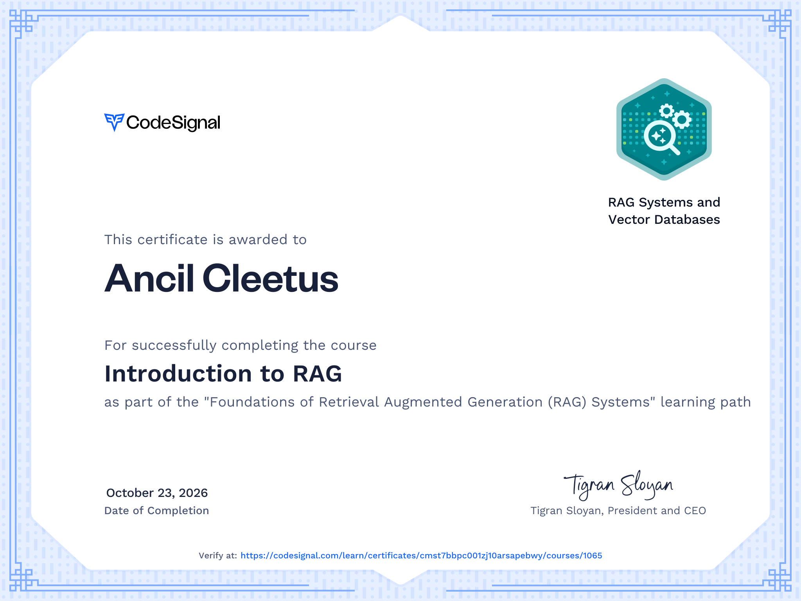
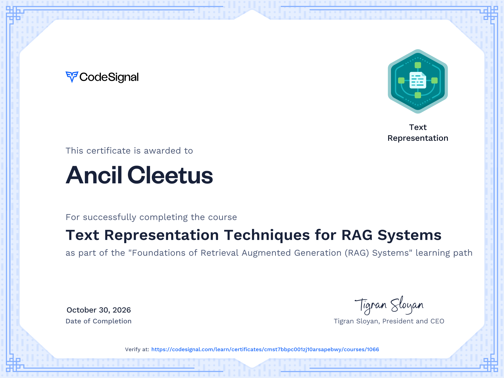

# **Foundations of Retrieval Augmented Generation (RAG) Systems**

Learn the essentials of Retrieval-Augmented Generation (RAG) to enhance text generation accuracy. This path covers RAG basics, vector databases, semantic retrieval with embeddings, and building a complete RAG pipeline.

## Course 1: Introduction to RAG    

Learn what Retrieval-Augmented Generation (RAG) is, why combining retrieval with generation can reduce hallucinations, and how a basic RAG workflow contrasts with naive prompting. This course is mostly informational, setting the stage for more hands-on work in later courses.

## Course 2: Text Representation Techniques for RAG Systems    

Learn essential text representation methods for RAG systems, from Bag-of-Words to embeddings. Explore how these techniques enhance understanding and retrieval, visualize embeddings with t-SNE, and compare BOW and embeddings in document retrieval and semantic search.

## Course 3: Scaling up RAG with Vector Databases    

Discover how to scale RAG systems using vector databases. Learn to preprocess documents, store embeddings in ChromaDB, retrieve relevant chunks, and construct prompts. Manage updates and large-scale ingestion with batch strategies for efficient retrieval.

## Course 4: Beyond Basic RAG: Improving our Pipeline    

Enhance your RAG pipeline with advanced retrieval techniques. Implement hybrid retrieval, iterative query refinement, and context summarization. Constrain LLM outputs to retrieved context, ensuring accuracy and minimizing hallucinations in final responses.

